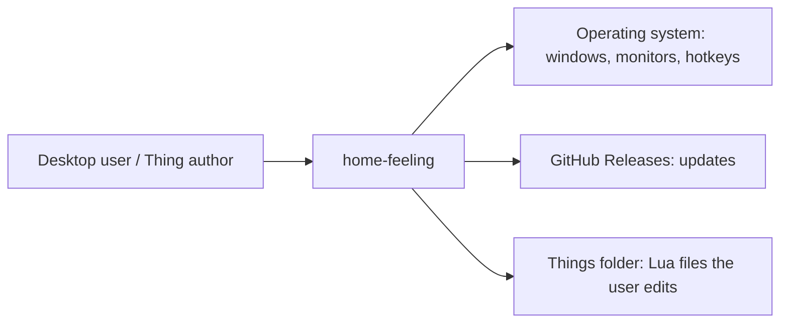
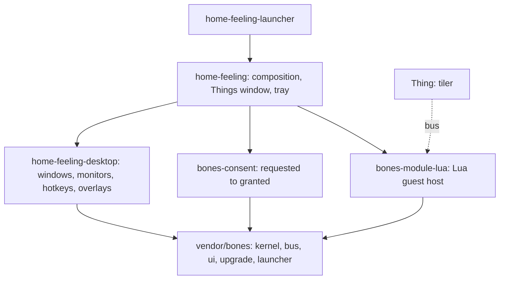

# Architecture

home-feeling is a native desktop application that embeds the [bones](https://github.com/an-dr/bones) engine. It owns its binary and composes bones modules with modules of its own. It reads Things from a folder in the user's home, controls the operating system through native modules, and updates itself from GitHub Releases.

## Components

| Component | Responsibility | Use cases |
| --- | --- | --- |
| `apps/home-feeling` | Composition root: composes bones and the modules below; owns the Things window, where it shows consent prompts, and the tray icon, which bones designs but does not implement yet; copies built-in Things into the Things folder and never overwrites a file the user edited | THINGS, INSTALL |
| `apps/home-feeling-launcher` | Stable entry point that starts the newest installed version | INSTALL, UPDATE |
| `crates/bones-module-lua` | Hosts Lua Things as bus guests with the contract of bones' WASM extensions: lifecycle, watchdog, quarantine, hot reload, deny-lists, `core/lifecycle` events ([ADR-001](adr/ADR-001-things-are-lua-guests-on-the-bones-bus.md), [ADR-002](adr/ADR-002-the-lua-host-mirrors-the-wasm-host-and-uses-luau.md)) | THINGS-02, 03, 04 |
| `crates/bones-consent` | Turns what a guest requests into what it may do: stores the user's answer per guest and request, offers the approval prompt as a widget tree, and gives the resulting deny-list to a guest host ([ADR-003](adr/ADR-003-capabilities-are-requested-by-the-guest-and-granted-by-the-user.md)) | THINGS-04 |
| `crates/home-feeling-desktop` | Native module giving the bus control of windows, monitors, global hotkeys, and overlays: lists and watches windows and monitors, moves and resizes windows, reports focus and hotkey events, draws borders and rectangles in click-through overlay windows; reports what the platform supports ([ADR-004](adr/ADR-004-os-control-is-mechanism-in-rust-and-policy-in-lua.md), [ADR-005](adr/ADR-005-desktop-overlays-belong-to-the-desktop-module.md)) | TILE |
| `things/tiler` | Built-in Lua Thing: dwindle layout per monitor, gaps, the minimum-size float rule, hotkey actions, and the focus border | TILE |
| `xtask` | Packaging: a zip and an update manifest per platform ([ADR-006](adr/ADR-006-distribution-follows-crosswall.md)) | RELEASE |
| `vendor/bones` | Submodule: kernel, bus, ui module, upgrade, launcher | all |

Dependencies point one way. The app depends on the modules, the modules depend only on bones, and Things depend only on bus topics. `bones-module-lua`, `bones-consent`, and `home-feeling-desktop` never depend on each other; the app connects consent to the Lua host. `bones-module-lua` and `bones-consent` name nothing of home-feeling, so they can move into bones unchanged.

## Guarantees

- **Things reach everything only through the bus.** A Thing has the four operations of a bones WASM extension (subscribe, publish, send, log) and draws only through `ui/spec` widget trees. It cannot open files, sockets, or processes: its Lua library is limited to pure computation.
- **A Thing cannot hang or crash the app.** Every call into a Thing runs under a time budget. A Thing that exceeds it, raises an error, or floods the bus is quarantined, and other Things keep running.
- **Reload is atomic per Thing.** The replacement is loaded and initialised before the old instance shuts down. If it fails, the old instance keeps running. In-memory state does not survive a reload; a Thing persists what it needs through bones persistence.
- **Stopping a Thing releases what it owns.** Its hotkeys, subscriptions, overlays, and UI are released when it stops or reloads.
- **Permissions are granted, never self-declared.** A Thing's manifest only requests capabilities. The user's answer, recorded by `bones-consent`, becomes the deny-list the composition root gives the Lua host.
- **Overlays never interfere.** An overlay takes no clicks, keyboard focus, or taskbar entry.
- **The user's files stay the user's.** An update replaces the installed app, never the Things folder.
- **The frame thread never waits on the operating system.** The desktop module gathers OS events on its own thread and delivers them as bus messages.

## Platform support in v1

| Capability | Windows | Linux |
| --- | --- | --- |
| Core, Things window, reload, consent | yes | yes |
| Tray icon | yes | no: the tray library needs a GTK loop the engine does not run |
| Window management, hotkeys, overlays | yes | reported unsupported |
| Install and self-update | yes | yes |

The Things folder is the user's configuration folder plus `home-feeling/things` (`%APPDATA%\home-feeling\things` on Windows, `~/.config/home-feeling/things` on Linux), outside the install folder, and `HOME_FEELING_THINGS_DIR` overrides it.

Wayland lets no ordinary client manage other applications' windows, so Linux tiling needs a backend per compositor. It is out of scope for v1.
